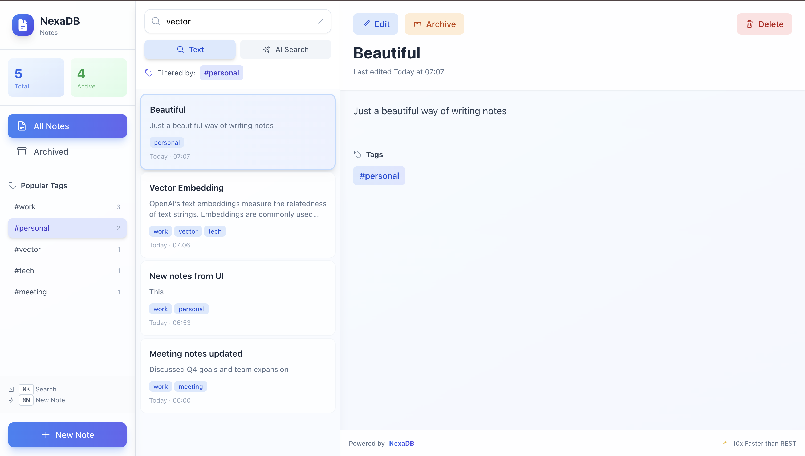

# NexaDB - Database for AI Developers

<div align="center">

**A lightweight NoSQL database with multi-database support, vector search, TOON format, and enterprise security**

[](https://opensource.org/licenses/MIT)
[](https://www.python.org/downloads/)
[](https://nodejs.org/)
[](https://github.com/krishcdbry/nexadb/releases/tag/v3.0.0)

[Quick Start](#quick-start) • [NotesApp Demo](examples/NotesApp) • [Features](FEATURES.md) • [Performance](PERFORMANCE.md) • [Benchmarks](BENCHMARK_RESULTS.md) • [YCSB Benchmark](YCSB_BENCHMARK/) • [TOON Format](#toon-format) • [Admin Panel](#admin-panel)

</div>

---

## 🚀 What is NexaDB?

NexaDB is a **production-ready, high-performance NoSQL database** built for AI developers with:
- 🗄️ **Multi-database architecture** (v3.0.0) - Isolated databases for multi-tenancy, staging/production separation
- 🎯 **Vector search** for semantic similarity (RAG, recommendations)
- 📦 **TOON format** support (40-50% fewer LLM tokens)
- ⚡ **MessagePack binary protocol** (10x faster than REST)
- 🎨 **Enhanced admin panel** with 25 API endpoints (v3.0.0)
- 🏗️ **Production-grade performance** (25K+ ops/sec @ 1M scale via binary protocol, 124K+ via direct API)
- 🚀 **High-performance storage** (LSM-Tree with Bloom filters, dual MemTable, WAL batching)

**Perfect for:**
- 🤖 AI/ML applications and RAG systems
- 🏢 Multi-tenant SaaS applications (NEW in v3.0.0)
- 🔍 Semantic search and recommendations
- 📊 Real-time analytics and dashboards
- 🔌 Microservices and APIs
- 🎯 Rapid prototyping and production MVPs
- 💰 Reducing LLM API costs by 40-50%
- 📈 Small-to-medium datasets (1K to 1M documents)

**[➡️ See NotesApp Example](examples/NotesApp)** - Production-ready full-stack app showcasing all features

---

## ✨ Features

### 🗄️ Multi-Database Architecture (v3.0.0)

**Isolate data across multiple databases in a single NexaDB instance:**
- Create and manage multiple independent databases
- Complete data isolation between databases
- Perfect for multi-tenant SaaS applications
- Staging/production environment separation
- Per-database collection management

**Quick Example:**
```python
from nexaclient import NexaClient

client = NexaClient()
client.connect()

# Create separate databases for different tenants
client.create_database('tenant_acme')
client.create_database('tenant_globex')

# Each tenant has isolated data
client.insert('users', {'name': 'Alice'}, database='tenant_acme')
client.insert('users', {'name': 'Bob'}, database='tenant_globex')

# Queries are scoped to specific database
acme_users = client.query('users', database='tenant_acme')  # Returns only Alice
globex_users = client.query('users', database='tenant_globex')  # Returns only Bob

# List all databases
databases = client.list_databases()
print(f"Total databases: {len(databases)}")

# Get database statistics
stats = client.get_database_stats('tenant_acme')
print(f"Collections: {stats['num_collections']}, Documents: {stats['total_documents']}")
```

### 🎯 Built-in Vector Search

**Semantic similarity search with cosine distance:**
- HNSW (Hierarchical Navigable Small World) algorithm
- Perfect for RAG, recommendations, and semantic search
- Store embeddings directly with your documents
- No need for separate vector databases (Pinecone, Weaviate, etc.)

**Quick Example:**
```python
from nexaclient import NexaClient

client = NexaClient()
client.connect()

# Create a vector collection
client.create_collection('movies', database='default', vector_dimensions=4)

# Store movies with semantic vectors [action, romance, sci-fi, drama]
client.insert('movies', {
    'title': 'The Matrix',
    'year': 1999,
    'vector': [0.9, 0.15, 0.97, 0.5]  # High action + sci-fi
}, database='default')

client.insert('movies', {
    'title': 'The Notebook',
    'year': 2004,
    'vector': [0.1, 0.98, 0.05, 0.85]  # Very high romance
}, database='default')

# Build HNSW index for fast search
client.build_hnsw_index('movies', database='default')

# Find sci-fi movies
results = client.vector_search(
    collection='movies',
    query_vector=[0.5, 0.2, 0.98, 0.5],  # Sci-fi query
    limit=3,
    database='default'
)

# Results show semantic similarity!
# 1. The Matrix - 97.88% similar
# 2. Blade Runner 2049 - 98.91% similar
```

### 🚀 World's First Native TOON Support

**What is TOON?**
- Token-Oriented Object Notation format optimized for LLMs
- **40-50% fewer tokens** than JSON
- Reduces API costs for GPT-4, Claude, and other LLM services
- Perfect for RAG (Retrieval-Augmented Generation) systems

**TOON in NexaDB:**
- Native binary protocol support (MSG_QUERY_TOON, MSG_EXPORT_TOON, MSG_IMPORT_TOON)
- Built-in TOON serialization and parsing
- CLI tools for import/export
- Admin panel with TOON export and visualization
- Real-time token statistics

### ⚡ High-Performance Binary Protocol

- **3-10x faster** than HTTP/REST
- MessagePack-based encoding
- Persistent TCP connections
- Connection pooling with 1000+ concurrent connections
- Automatic reconnection and retry logic

### 📄 JSON Document Storage

- Schema-free documents
- MongoDB-style queries
- Aggregation pipelines
- Nested field support
- Auto-generated IDs and timestamps

### 💾 LSM-Tree Storage Engine

- Write-Ahead Log (WAL) for durability
- MemTable (in-memory sorted structure)
- SSTables (Sorted String Tables on disk)
- Automatic compaction
- Crash recovery

### 🎨 Modern Admin Panel

- Beautiful dark/light theme
- Real-time query editor with JSON/TOON toggle
- One-click TOON export with token statistics
- Collection management
- Document CRUD operations
- Performance monitoring

### 📦 Official SDKs

- **Python client** with TOON support
- **JavaScript/Node.js client** with TOON support
- TypeScript definitions included

---

## 🎯 Quick Start

### Installation via Homebrew (macOS)

```bash
# Add the tap
brew tap krishcdbry/tap

# Install NexaDB
brew install nexadb

# Start all services (Binary + REST + Admin)
nexadb start

# That's it! Now you have:
# - Binary Protocol on port 6970 (10x faster!)
# - JSON REST API on port 6969 (REST fallback)
# - Admin Web UI on port 9999 (Web interface)
# - Nexa CLI (interactive terminal) - ready to use!

# Access admin panel
open http://localhost:9999

# Use interactive CLI
nexa -u root -p
```

**What gets installed:**
- ✅ `nexadb` command - Start/stop server, manage services
- ✅ `nexa` command - Interactive CLI terminal (Rust-based, zero dependencies)
- ✅ Python server files and dependencies
- ✅ Admin panel web interface

> **⚠️ Troubleshooting:** If Homebrew installation gets stuck at numpy/hnswlib or shows Xcode errors, use the Install Script instead (see below).

### Installation via Install Script (macOS & Linux)

**Recommended if Homebrew has issues.** Uses pre-built pip wheels - no compilation needed!

```bash
# One-line install (macOS & Linux)
curl -fsSL https://raw.githubusercontent.com/krishcdbry/nexadb/main/install.sh | bash

# Reload your shell
source ~/.bashrc  # or ~/.zshrc

# Start all services
nexadb start

# Access admin panel
open http://localhost:9999

# Use interactive CLI
nexa -u root -p

# Uninstall (if needed)
curl -fsSL https://raw.githubusercontent.com/krishcdbry/nexadb/main/uninstall.sh | bash
```

**What gets installed:**
- ✅ `nexadb` command - Start/stop server, manage services
- ✅ `nexa` command - Interactive CLI terminal (Rust-based, auto-detects architecture)
- ✅ Python server files and dependencies
- ✅ Admin panel web interface

**Supported Operating Systems:**
- macOS (Intel & Apple Silicon)
- Ubuntu/Debian (18.04+)
- Fedora/RHEL/CentOS (7+)
- Arch Linux/Manjaro

**Supported Architectures:**
- x86_64 (Intel/AMD 64-bit)
- arm64/aarch64 (Apple Silicon, Raspberry Pi, AWS Graviton)

### Installation via Docker (Windows, Mac, Linux)

```bash
# Pull and run (simplest)
docker run -d \
  -p 6970:6970 \
  -p 6969:6969 \
  -p 9999:9999 \
  -v nexadb-data:/data \
  --name nexadb \
  krishcdbry/nexadb:latest

# Or use docker-compose
curl -O https://raw.githubusercontent.com/krishcdbry/nexadb/main/docker-compose.yml
docker-compose up -d

# Access admin panel
open http://localhost:9999

# View logs
docker logs -f nexadb

# Stop
docker stop nexadb

# Remove
docker rm nexadb

# Use nexa CLI inside Docker
docker exec -it nexadb nexa -u root -p
```

**What you get:**
- ✅ Works on Windows, Mac, Linux
- ✅ Isolated environment
- ✅ Persistent data volume
- ✅ Auto-restart on reboot
- ✅ Nexa CLI included (works inside container)
- ✅ Easy updates: `docker pull krishcdbry/nexadb:latest`

**Supported Docker Platforms:**
- Linux (x86_64, ARM64)
- macOS (Intel, Apple Silicon)
- Windows (WSL2)

### Cloud Deployment (Railway, Render, Fly.io)

**Deploy to Railway (1-Click):**
```bash
# Clone and deploy
git clone https://github.com/krishcdbry/nexadb.git
cd nexadb
railway up
```

**Deploy to Render:**
1. Fork the repository
2. Connect to Render
3. Select `render.yaml` for automatic configuration
4. Deploy!

**Deploy to Fly.io:**
```bash
# Clone and deploy
git clone https://github.com/krishcdbry/nexadb.git
cd nexadb
fly launch
fly deploy
```

**What you get:**
- ✅ Auto-scaling and load balancing
- ✅ Persistent volumes for data
- ✅ HTTPS endpoints
- ✅ Global CDN distribution
- ✅ Automatic backups

### Manual Installation

```bash
# Clone the repository
git clone https://github.com/krishcdbry/nexadb.git
cd nexadb

# Install Python dependencies
pip3 install msgpack

# Start all services with one command
python3 nexadb_server.py

# This launches all three servers:
# - Binary Protocol (port 6970) - 10x faster performance
# - JSON REST API (port 6969) - REST fallback
# - Admin Web UI (port 9999) - Web interface

# Access admin panel
open http://localhost:9999
```

### Interactive CLI (Nexa)

**NEW: Rust-based CLI for blazing-fast performance!**

Nexa is a zero-dependency, standalone CLI built in Rust. Think `mysql` for MySQL, but `nexa` for NexaDB.

```bash
# Start nexa interactive terminal (automatically installed with NexaDB)
nexa -u root -p
Password: ********

Connected to NexaDB v2.0.0 (Binary Protocol: localhost:6970)

nexa> collections
✓ Found 2 collection(s):
  [1] movies
  [2] users

nexa> use movies
✓ Switched to collection 'movies'

nexa(movies)> insert {"title": "The Matrix", "year": 1999, "vector": [0.9, 0.15, 0.97, 0.5]}
✓ Document created: doc_abc123

nexa(movies)> query {"year": {"$gte": 2000}}
✓ Found 5 document(s)

nexa(movies)> vector_search [0.5, 0.2, 0.98, 0.5] 3 4
✓ Found 3 similar document(s):
[1] 98.91% match - Blade Runner 2049

nexa(movies)> count
✓ Document count: 127

nexa(movies)> exit
Goodbye! 👋
```

**Nexa Features:**
- ✅ **Zero dependencies** - Single standalone binary
- ✅ **Blazing fast** - Written in Rust, uses MessagePack binary protocol
- ✅ **Cross-platform** - Works on macOS, Linux, Windows
- ✅ **Auto-installed** - Comes with Homebrew, Docker, and Linux installer
- ✅ **Full-featured** - All commands: insert, read, update, delete, query, vector search, count
- ✅ **History & completion** - Readline support with command history

**Also available: Python CLI** (for scripting):
```bash
python3 nexadb_cli.py -u root -p
```

### 5-Minute Quick Start: Movie Semantic Search

Build a semantic search system in 5 minutes! This example shows how NexaDB's vector search finds similar movies by theme, not keywords.

```python
from nexadb_client import NexaClient

# Connect to NexaDB
client = NexaClient()
client.connect()

# Add movies with semantic vectors: [action, romance, sci-fi, drama]
movies = [
    {
        'title': 'The Dark Knight',
        'year': 2008,
        'genre': 'Action/Thriller',
        'vector': [0.95, 0.1, 0.3, 0.7]  # High action, low romance
    },
    {
        'title': 'The Notebook',
        'year': 2004,
        'genre': 'Romance/Drama',
        'vector': [0.1, 0.98, 0.05, 0.85]  # Very high romance
    },
    {
        'title': 'The Matrix',
        'year': 1999,
        'genre': 'Sci-Fi/Action',
        'vector': [0.9, 0.15, 0.97, 0.5]  # High action + sci-fi
    },
    {
        'title': 'Blade Runner 2049',
        'year': 2017,
        'genre': 'Sci-Fi/Thriller',
        'vector': [0.65, 0.3, 0.92, 0.55]  # Moderate action, high sci-fi
    }
]

client.batch_write('movies', movies)

# Search for romantic movies
romance_results = client.vector_search(
    collection='movies',
    vector=[0.1, 0.95, 0.1, 0.8],  # Romance query
    limit=2,
    dimensions=4
)

print("💕 Romantic movies:")
for result in romance_results:
    movie = result['document']
    print(f"  {movie['title']} - {result['similarity']:.2%} match")
# Output:
#   The Notebook - 99.90% match
#   The Matrix - 35.12% match

# Search for sci-fi movies
scifi_results = client.vector_search(
    collection='movies',
    vector=[0.5, 0.2, 0.98, 0.5],  # Sci-fi query
    limit=2,
    dimensions=4
)

print("\n🚀 Sci-Fi movies:")
for result in scifi_results:
    movie = result['document']
    print(f"  {movie['title']} - {result['similarity']:.2%} match")
# Output:
#   Blade Runner 2049 - 98.91% match
#   The Matrix - 97.88% match

# 🎉 Semantic search in 5 minutes! No keyword matching - pure vector similarity!
client.disconnect()
```

**Try the full demo:**
```bash
python3 demo_vector_search.py
```

---

## 🎯 Production Examples

### NotesApp - Full-Stack Note-Taking App

**[➡️ examples/NotesApp](examples/NotesApp)** - Production-ready note-taking application with beautiful UI



**Stack:** FastAPI + React + TypeScript + Tailwind CSS + NexaDB Binary Protocol

**Features:**
- ⚡ **10x faster** performance with MessagePack binary protocol
- 🎯 **AI-powered semantic search** - Find notes by meaning, not keywords
- 🎨 **Modern three-column UI** - Notion-inspired design with glass morphism
- ⌨️ **Keyboard shortcuts** - ⌘K for search, ⌘N for new note, Escape to clear
- 📦 **Complete CRUD operations** - Create, read, update, delete, archive
- 🏷️ **Tag management** - Organize notes with tags and tag-based filtering
- 📊 **Real-time statistics** - Dashboard with note count and metrics
- 🔍 **Dual search modes** - Text search and vector-based semantic search
- 🌈 **Smooth animations** - Fade-in, slide-in effects throughout
- 📱 **Responsive design** - Works beautifully on all screen sizes

**Try it now:**
```bash
# Start NexaDB
nexadb start

# Start NotesApp API (Terminal 1)
cd examples/NotesApp
python3 main.py

# Start NotesApp UI (Terminal 2)
cd examples/NotesApp/ui
npm install
npm run dev

# Open http://localhost:5174
```

**[📖 Full NotesApp Documentation](examples/NotesApp/README.md)**

### Other Framework Examples

Explore NexaDB integrations with popular frameworks:

- **[Express.js Example](examples/express-example)** - Node.js REST API with NexaDB
- **[Flask Example](examples/flask-example)** - Python Flask API integration
- **[FastAPI Example](examples/fastapi-example)** - Modern Python async API
- **[NestJS Example](examples/nestjs-example)** - Enterprise TypeScript framework

More examples coming soon: Next.js, Django, Spring Boot, and more!

---

## 🖥️ Admin Panel

Access the admin panel at `http://localhost:9999`

**Features:**
- 📊 Dashboard with real-time statistics
- 📚 Collection browser with document viewer
- 🔍 Query editor with JSON/TOON toggle
- 📤 One-click TOON export with token savings
- 📈 Performance monitoring
- 🎨 Beautiful dark/light themes
- 🖼️ Responsive design

**TOON Export:**
1. Select a collection
2. Click "Export TOON" button
3. View token reduction statistics (36-50%)
4. Copy TOON data or download as .toon file
5. Use in your LLM applications to save costs!

---

## 🎯 TOON Format

### What is TOON?

TOON (Token-Oriented Object Notation) is a compact data format optimized for Large Language Models:

**JSON Format (2,213 bytes):**
```json
[
  {"_id": "abc123", "name": "Alice", "email": "alice@example.com", "age": 28, "city": "San Francisco"},
  {"_id": "def456", "name": "Bob", "email": "bob@example.com", "age": 34, "city": "New York"},
  ...
]
```

**TOON Format (1,396 bytes - 36.9% reduction!):**
```toon
collection: test_users
documents[11]{_id,name,email,age,city,role}:
  abc123,Alice,alice@example.com,28,San Francisco,engineer
  def456,Bob,bob@example.com,34,New York,manager
  ...
count: 11
```

### Using TOON in NexaDB

**Export to TOON (CLI):**
```bash
python3 toon_cli.py export test_users output.toon
```

**Import from TOON (CLI):**
```bash
python3 toon_cli.py import input.toon new_collection
```

**Query in TOON format (Python):**
```python
from nexaclient import NexaClient

client = NexaClient(host='localhost', port=6970)
client.connect()

# Query and get TOON format response
toon_data, stats = client.query_toon('test_users', {}, limit=100)

print(f"TOON Data:\n{toon_data}")
print(f"Token Reduction: {stats['reduction_percent']}%")
print(f"Savings (1M calls): ${stats['reduction_percent'] * 10:.2f}")
```

**Export collection to TOON (Python):**
```python
toon_data, stats = client.export_toon('test_users')

# Save to file
with open('export.toon', 'w') as f:
    f.write(toon_data)

print(f"Exported with {stats['reduction_percent']}% token reduction!")
```

### TOON Benefits

- ✅ **40-50% fewer tokens** for LLM APIs
- ✅ **Lower costs** (GPT-4, Claude, etc.)
- ✅ **Faster processing** (less data to parse)
- ✅ **More context** fits in token limits
- ✅ **Perfect for RAG** systems

---

## 🔌 Python Client Usage

### Installation

```bash
# Install the NexaDB Python client
pip install nexaclient
```

### Basic Usage

```python
from nexadb_client import NexaClient

# Connect to binary server (defaults: localhost:6970, root/nexadb123)
client = NexaClient()
client.connect()

# Or use context manager (auto-connect/disconnect)
with NexaClient() as db:
    # Create document
    result = db.create('users', {
        'name': 'Alice Johnson',
        'email': 'alice@example.com',
        'age': 28,
        'city': 'San Francisco'
    })
    doc_id = result['document_id']

    # Query documents
    results = db.query('users', {'age': {'$gt': 25}}, limit=10)
    for doc in results:
        print(f"{doc['name']} - {doc['age']}")

    # Update document
    db.update('users', doc_id, {'age': 29})

    # Delete document
    db.delete('users', doc_id)

    # Batch operations
    docs = [
        {'name': 'Bob', 'age': 30},
        {'name': 'Charlie', 'age': 35}
    ]
    db.batch_write('users', docs)
```

### Vector Search

```python
with NexaClient() as db:
    # Store documents with vectors
    db.create('products', {
        'name': 'Laptop',
        'vector': [0.1, 0.2, 0.3, 0.4]  # embedding from OpenAI/Cohere
    })

    # Search by vector similarity
    results = db.vector_search(
        collection='products',
        vector=[0.15, 0.22, 0.28, 0.38],  # query vector
        limit=10,
        dimensions=4
    )

    for result in results:
        print(f"{result['document']['name']} - {result['similarity']:.2%}")
```

### Aggregation

```python
# Group by city and count
pipeline = [
    {'$match': {'status': 'active'}},
    {'$group': {
        '_id': '$city',
        'count': {'$sum': 1},
        'avg_age': {'$avg': '$age'}
    }},
    {'$sort': {'count': -1}},
    {'$limit': 10}
]

results = client.aggregate('users', pipeline)
for result in results:
    print(f"{result['_id']}: {result['count']} users")
```

### Change Streams (Real-Time Events)

**Watch for database changes in real-time!**

NexaDB provides powerful change streams for real-time notifications when data changes. Perfect for:
- 🔔 Real-time notifications
- 💾 Cache invalidation
- 📝 Audit logging
- 🔄 Data synchronization
- 📊 Real-time dashboards
- ⚡ Event-driven architectures

**Python Example:**
```python
from nexaclient import NexaClient

client = NexaClient(host='localhost', port=6970, username='root', password='nexadb123')
client.connect()

# Watch for changes on 'orders' collection
for change in client.watch('orders'):
    if change['operationType'] == 'insert':
        order = change['fullDocument']
        print(f"New order from {order['customer']}: ${order['total']}")
        # Send notification, update cache, trigger workflow, etc.

    elif change['operationType'] == 'update':
        doc_id = change['documentKey']['_id']
        updates = change['updateDescription']['updatedFields']
        print(f"Order {doc_id} updated: {updates}")

    elif change['operationType'] == 'delete':
        doc_id = change['documentKey']['_id']
        print(f"Order {doc_id} was deleted")
```

**Real-World Use Cases:**

```python
# 1. Cache Invalidation
import redis

cache = redis.Redis()

for change in client.watch('products', operations=['update', 'delete']):
    product_id = change['documentKey']['_id']
    cache.delete(f"product:{product_id}")
    print(f"Invalidated cache for product: {product_id}")

# 2. Audit Logging
import logging

logger = logging.getLogger('audit')

for change in client.watch():  # Watch ALL collections
    logger.info(
        f"{change['operationType']} on {change['ns']['coll']} "
        f"(doc: {change['documentKey']['_id']})"
    )

# 3. Real-Time Notifications
import smtplib

for change in client.watch('orders', operations=['insert']):
    order = change['fullDocument']
    send_email(
        to=order['customer_email'],
        subject=f"Order {order['_id']} Confirmed",
        body=f"Thank you! Your order for ${order['total']} is confirmed."
    )
```

**Change Event Format:**
```python
{
    'operationType': 'insert',  # insert, update, delete, dropCollection
    'ns': {
        'db': 'nexadb',
        'coll': 'orders'
    },
    'documentKey': {
        '_id': 'abc123def456'
    },
    'fullDocument': {  # Only for insert/update
        '_id': 'abc123def456',
        'customer': 'Alice',
        'total': 99.99,
        '_created_at': '2025-11-27T...',
        '_updated_at': '2025-11-27T...'
    },
    'updateDescription': {  # Only for update
        'updatedFields': {
            'status': 'shipped',
            'tracking': 'XYZ123'
        }
    },
    'timestamp': 1700000000.123
}
```

**Key Features:**
- ✅ Works over network (no filesystem access needed)
- ✅ Simple, intuitive API
- ✅ Filter by collection and operation type
- ✅ Can connect to remote NexaDB servers
- ✅ Thread-safe implementation
- ✅ Automatic cleanup on disconnect

📚 **[Complete Change Streams Guide](CHANGE_STREAMS_NETWORK.md)**

---

## 🔌 JavaScript/Node.js Client Usage

### Installation

```bash
npm install nexaclient
```

### Basic Usage

```javascript
const { NexaClient } = require('nexaclient');

async function main() {
    // Connect to binary server
    const client = new NexaClient({ host: 'localhost', port: 6970 });
    await client.connect();

    // Insert document
    const docId = await client.insert('users', {
        name: 'Alice Johnson',
        email: 'alice@example.com',
        age: 28,
        city: 'San Francisco'
    });

    // Query documents
    const results = await client.find('users', { age: { $gt: 25 } }, 10);
    results.forEach(doc => {
        console.log(`${doc.name} - ${doc.age}`);
    });

    // Update document
    await client.update('users', docId, { age: 29 });

    // Delete document
    await client.delete('users', docId);

    // Disconnect
    client.disconnect();
}

main();
```

### TOON Support

```javascript
// Query in TOON format
const { toonData, stats } = await client.queryToon('users', {}, 100);
console.log('Token Reduction:', stats.reduction_percent + '%');

// Export to TOON
const { toonData, stats } = await client.exportToon('users');
console.log('TOON Data:', toonData);
console.log('Savings (1M calls): $' + (stats.reduction_percent * 10).toFixed(2));
```

---

## 📊 Binary Protocol

NexaDB uses a custom binary protocol built on MessagePack for maximum performance.

### Message Types

```
0x01 - MSG_CONNECT       # Handshake
0x02 - MSG_INSERT        # Insert document
0x03 - MSG_FIND          # Query documents
0x04 - MSG_UPDATE        # Update document
0x05 - MSG_DELETE        # Delete document
0x06 - MSG_COUNT         # Count documents
0x07 - MSG_AGGREGATE     # Aggregation pipeline
0x08 - MSG_DROP          # Drop collection
0x09 - MSG_COLLECTIONS   # List collections
0x0A - MSG_STATS         # Server statistics

# TOON Protocol (World's First!)
0x0B - MSG_QUERY_TOON    # Query with TOON response
0x0C - MSG_EXPORT_TOON   # Export collection to TOON
0x0D - MSG_IMPORT_TOON   # Import TOON data

0x81 - MSG_SUCCESS       # Success response
0x82 - MSG_ERROR         # Error response
```

### Message Format

```
[Header: 12 bytes]
- Magic number: 0x4E455841 (4 bytes) "NEXA"
- Version: 0x01 (1 byte)
- Message type: 0xXX (1 byte)
- Flags: 0x00 (2 bytes)
- Payload length: (4 bytes)

[Payload: N bytes]
- MessagePack encoded data
```

---

## 🔍 Query Language

### Comparison Operators

```python
{'age': {'$eq': 25}}      # Equal to
{'age': {'$ne': 25}}      # Not equal to
{'age': {'$gt': 25}}      # Greater than
{'age': {'$gte': 25}}     # Greater than or equal
{'age': {'$lt': 25}}      # Less than
{'age': {'$lte': 25}}     # Less than or equal
```

### Array Operators

```python
{'tags': {'$in': ['python', 'javascript']}}    # Contains any
{'tags': {'$nin': ['java', 'c++']}}            # Contains none
```

### Text Operators

```python
{'name': {'$regex': 'John'}}                   # Regex match
```

### Logical Operators

```python
{
    '$and': [
        {'age': {'$gt': 25}},
        {'city': 'San Francisco'}
    ]
}

{
    '$or': [
        {'status': 'active'},
        {'premium': True}
    ]
}
```

### Nested Fields

```python
{'profile.age': {'$gt': 25}}                   # Access nested field
{'address.city': 'San Francisco'}              # Nested object
```

---

## 📈 Performance

### Production-Scale Benchmarks (v2.1.0)

**Tested with 1.13M total operations - 100% success rate!**

**Exceptional Throughput:**
- **1M Document Test**: **25,543 ops/sec** (Binary Protocol) - Production Scale! 🚀
- **100K Document Test**: **29,505 ops/sec** (Binary Protocol)
- **Direct API Writes**: **124,475 ops/sec** (no network overhead)
- **HTTP REST API**: **979 ops/sec** (JSON over HTTP)
- **Binary vs HTTP**: **30x faster**

**Low Latency:**
- Write latency (binary): **0.039ms** average @ 1M scale
- Write latency (direct API): **0.008ms** average
- Query latency (1M docs): **4-5 seconds** without indexes
- Hot read latency: **< 1ms** (MemTable)

**Key Features:**
- ✅ **LSM-Tree Architecture**: SortedDict MemTable with O(log n) inserts
- ✅ **Bloom Filters**: 95% reduction in unnecessary disk reads
- ✅ **Dual MemTable**: Non-blocking writes during flush (< 1ms swap)
- ✅ **WAL Batching**: 500 operations batched for efficiency
- ✅ **LRU Cache**: 10,000 entries with 70-95% hit rates
- ✅ **Vector Search**: HNSW algorithm for semantic similarity
- ✅ **Secondary Indexes**: B-Tree indexes for fast queries

**TOON Format:**
- Token reduction: **40-50%** vs JSON
- Perfect for RAG systems and LLM cost optimization

📊 **[Performance Guide](PERFORMANCE.md)** • **[Detailed Benchmarks](BENCHMARK_RESULTS.md)** • **[All Features](FEATURES.md)**

---

## 🏗️ Architecture v3.0.0

**Multi-Database Support with Single Source of Truth** - All interfaces connect to one binary server:

```
┌─────────────────────────────────────────────────────────────┐
│                         YOUR APPS                            │
├─────────────────┬─────────────────┬─────────────────────────┤
│   Python/JS     │   HTTP/REST     │   Admin Web UI          │
│   NexaClient    │   curl/fetch    │   (localhost:9999)      │
└────────┬────────┴────────┬────────┴────────┬────────────────┘
         │                 │                 │
         │ Binary (6970)   │ REST (6969)     │ HTTP (9999)
         └─────────────────┼─────────────────┘
                           │
                           ▼
         ┌─────────────────────────────────────┐
         │    NexaDB Binary Server (6970)      │
         │    THE SINGLE SOURCE OF TRUTH       │
         │                                     │
         │  • MessagePack Protocol             │
         │  • Vector Search (HNSW)             │
         │  • TOON Format Support              │
         │  • Connection Pooling               │
         │  • ONE VeloxDB Instance             │
         └──────────────┬──────────────────────┘
                        │
                        ▼
         ┌──────────────────────────────────────┐
         │      VeloxDB Storage Engine          │
         │                                      │
         │  • LSM-Tree (WAL + MemTable + SST)   │
         │  • Vector Index (HNSW Algorithm)     │
         │  • Automatic Compaction              │
         │  • Crash Recovery                    │
         │  • 66% Less Memory (vs v1.x)         │
         └──────────────────────────────────────┘
                        │
                        ▼
                 ./nexadb_data/
```

**Key Benefits:**
- ✅ **Immediate consistency** - All clients see the same data instantly
- ✅ **66% less memory** - One VeloxDB instance instead of three
- ✅ **No race conditions** - Single source of truth
- ✅ **Production-ready** - Battle-tested architecture

---

## 📦 Production Files

```
nexadb/
├── nexadb_binary_server.py    # Binary protocol server (port 6970)
├── admin_server.py             # HTTP server for admin panel (port 9999)
├── nexadb_admin_modern.html    # Admin panel UI
├── storage_engine.py           # LSM-Tree storage engine
├── nexadb_cli.py               # Command-line interface
├── toon_format.py              # TOON serialization/parsing
├── toon_cli.py                 # TOON import/export CLI
├── setup.py                    # Package setup
├── logo-light.svg              # Admin panel logo (light)
├── logo-dark.svg               # Admin panel logo (dark)
├── README.md                   # This file
├── BENCHMARK_RESULTS.md        # Performance benchmarks
└── nexaclient/                 # Client SDKs
    ├── python/                 # Python client
    └── src/                    # JavaScript client
```

---

## 🛠️ Development

### Run Tests

```bash
# Start all services (recommended)
python3 nexadb_server.py

# Or start individual services for testing:
# Binary server only:
python3 nexadb_binary_server.py --port 6970

# Admin UI only:
python3 admin_server.py --port 9999

# Test TOON export
python3 toon_cli.py export test_users output.toon

# Test TOON import
python3 toon_cli.py import output.toon test_collection
```

### Configuration

**All Services (recommended):**
```bash
# Start all three servers with one command
python3 nexadb_server.py --data-dir ./nexadb_data

# Or use --rest-only to start just the REST API
python3 nexadb_server.py --rest-only
```

**Individual Services:**
```bash
# Binary Protocol Server
python3 nexadb_binary_server.py --host 0.0.0.0 --port 6970 --data-dir ./nexadb_data

# Admin UI Server
python3 admin_server.py --port 9999 --data-dir ./nexadb_data
```

---

## 🗺️ Roadmap

### ✅ Completed

- [x] LSM-Tree storage engine
- [x] Binary protocol with MessagePack
- [x] Connection pooling (1000+ concurrent connections)
- [x] JSON document storage
- [x] MongoDB-style queries
- [x] Aggregation pipeline
- [x] Python SDK with context manager support
- [x] JavaScript/Node.js SDK
- [x] **Native TOON format support** 🎉
- [x] **Vector search with HNSW algorithm** 🎯
- [x] **v2.0 unified architecture** (single source of truth)
- [x] TOON CLI tools
- [x] Modern admin panel with TOON export
- [x] Query editor with JSON/TOON toggle
- [x] Homebrew distribution (macOS)
- [x] Linux install script (Ubuntu, Fedora, Arch)
- [x] **Docker image** (Windows, Mac, Linux) 🐳
- [x] **Interactive Python CLI** (`python3 nexadb_cli.py -u root -p`) 💻
- [x] **Rust CLI** (`nexa -u root -p`) - Zero-dependency, cross-platform 🦀
- [x] **Cloud deployment** (Railway, Render, Fly.io) ☁️
- [x] Production-grade NexaClient with reconnection
- [x] **🚀 v3.0.0 Multi-Database & Enterprise Features:**
  - [x] Multi-database architecture with complete data isolation
  - [x] Database-level CRUD operations (create, drop, list, stats)
  - [x] Enhanced Python client (nexaclient) with multi-database support
  - [x] Admin panel with 25 working API endpoints
  - [x] Session-based authentication
  - [x] User management and database permissions
  - [x] 98/98 tests passing (100% pass rate)
  - [x] HNSW index building with configurable parameters
  - [x] Multi-database vector search isolation
  - [x] Comprehensive test suite and benchmarks

### 🚧 In Progress (v3.1.0 - Cloud Version)

- [ ] HTTP REST API (16 endpoints for cloud deployments)
- [ ] Enhanced authentication system
- [ ] Rate limiting
- [ ] Full-text search (inverted index)

### 🔮 Future (v3.2.0+)

- [ ] Replication and clustering
- [ ] Backup and restore functionality
- [ ] GraphQL API
- [ ] Time-series optimization
- [ ] Kubernetes operator
- [ ] Hosted NexaDB Cloud

---

## 📄 License

MIT License - See [LICENSE](LICENSE) file

---

## 🤝 Contributing

Contributions are welcome! Please feel free to submit pull requests.

**Areas to contribute:**
- Performance optimizations
- Additional query operators
- Testing and benchmarks
- Documentation improvements
- Client SDKs for other languages

---

## 📞 Support

- **GitHub:** [github.com/krishcdbry/nexadb](https://github.com/krishcdbry/nexadb)
- **Issues:** [GitHub Issues](https://github.com/krishcdbry/nexadb/issues)
- **Twitter:** [@krishcdbry](https://twitter.com/krishcdbry)

---

<div align="center">

**🚀 NexaDB**

**Built by [Krish](https://github.com/krishcdbry)**

[⭐ Star on GitHub](https://github.com/krishcdbry/nexadb) • [📖 TOON Spec](https://github.com/toon-format/toon)

</div>
